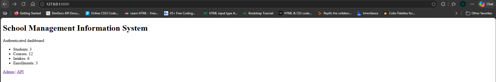

# School Management Information System (SMIS)

A portfolio project built with Python, Django, Django REST Framework and MySQL. It combines relational database work with a web dashboard and REST API for managing core academic records.

I developed the database components first, then built the Django application around providers, courses, intakes, students and enrollments. The project has also given me practical experience troubleshooting database connections, configuring authentication and testing API endpoints.

## What it does

**Web dashboard**
- Displays counts for students, courses, intakes and enrollments.
- Requires users to log in.
- Uses Django's authentication system and MySQL database.

**REST API**

The Django REST Framework API provides authenticated endpoints for:

- Course providers
- Courses
- Intakes
- Students
- Enrollments

The viewsets support standard create, read, update and delete operations. Related database records are retrieved using `select_related()` where appropriate.

Local API address: `http://127.0.0.1:8000/api/`

**Database and SQL**

The wider database work also covers student and guardian records, fee components, partial payments, outstanding balances, examinations, results, attendance, graduation records and SQL reporting.

These are part of the broader database work; they are not all implemented as features in the current Django application.

## Technology

| Technology | Use |
|---|---|
| Python 3.12 | Application logic |
| Django 5.2 | Web application |
| Django REST Framework | REST API |
| MySQL 8.4 | Relational database |
| Django ORM | Models and database queries |
| MySQL Workbench | Database administration and inspection |
| Postman | API testing |
| Git and GitHub | Version control |

## Architecture

```text
             Users
               |
       +-------+-------+
       |               |
   Dashboard         REST API
       |               |
       +-------+-------+
               |
             Django
       (Views and Models)
               |
             MySQL
```

Both the dashboard and API use Django and share the same MySQL database.

## Screenshots

### Dashboard



### API

**API root**


**Students**


**Courses**


**Intakes**


**Enrollments**


## Run locally

### Requirements

- Python 3.12
- MySQL 8.4
- Git

### 1. Clone the repository

```powershell
git clone https://github.com/davidwanjohi-it/school-management-information-system.git
cd school-management-information-system
```

### 2. Create a virtual environment

```powershell
python -m venv .venv
.\.venv\Scripts\Activate.ps1
```

### 3. Install dependencies

```powershell
python -m pip install -r requirements.txt
```

### 4. Configure the environment

Create a `.env` file in the project root using `.env.example` as a guide. Set your own Django secret key and MySQL connection details.

Do not commit `.env` or publish real credentials.

### 5. Prepare the database

Create the MySQL database and configure an account with the necessary permissions. Then run:

```powershell
cd smis_web
python manage.py migrate
```

### 6. Start the application

```powershell
python manage.py runserver
```

Open `http://127.0.0.1:8000/` for the dashboard or `http://127.0.0.1:8000/api/` for the API.

The API resources require authentication.

## Testing

The project includes basic Django tests. During development, I have also checked Django's configuration, verified migration status and tested the application's MySQL connection.

API endpoints can be explored using Postman or Django REST Framework's browsable API.

## Project structure

```text
school-management-information-system/
├── docs/
│   ├── screenshots/
│   ├── ARCHITECTURE.md
│   └── ROADMAP_COMPLETION.md
├── mysql_admin/
│   ├── 01_create_app_user.sql
│   └── 02_backup_restore.md
├── portfolio/
│   └── PROJECT_STORY.md
├── postman/
│   └── API_GUIDE.md
├── smis_web/
│   ├── config/
│   ├── core/
│   ├── templates/
│   └── manage.py
├── sql/
│   └── advanced_reports_42_50.sql
├── .env.example
├── .gitignore
├── README.md
└── requirements.txt
```

## What I'm working on next

I want to expand the automated tests, strengthen API validation and permissions, and continue developing the database reporting work.

A longer-term idea is to build a separate public-facing school website for school information, programmes, admissions and enquiries. That website could eventually communicate with the management system through authenticated APIs. It has not been implemented yet.

## Other work

I'm also building a network security auditing lab, where I practise log analysis and security monitoring using Splunk, including an alert workflow that creates Jira tickets.

- GitHub profile: https://github.com/davidwanjohi-it
- Network Security Auditing Lab: https://github.com/davidwanjohi-it/network-security-auditing

## Copyright

Copyright © 2026 David Wanjohi Rubucwa. All rights reserved.

This repository is published for portfolio review and demonstration of my software development work. No permission is granted to reproduce, redistribute, modify or commercially exploit my original source code or documentation, except where permitted by applicable law or with explicit written permission.

Third-party libraries and components remain subject to their respective licenses. Viewing this repository does not transfer ownership of the original work.

## Project status

This is an ongoing portfolio project. The Django dashboard and REST API cover core academic records, supported by broader MySQL database design and SQL work. It is not presented as a fully deployed production school management system.
